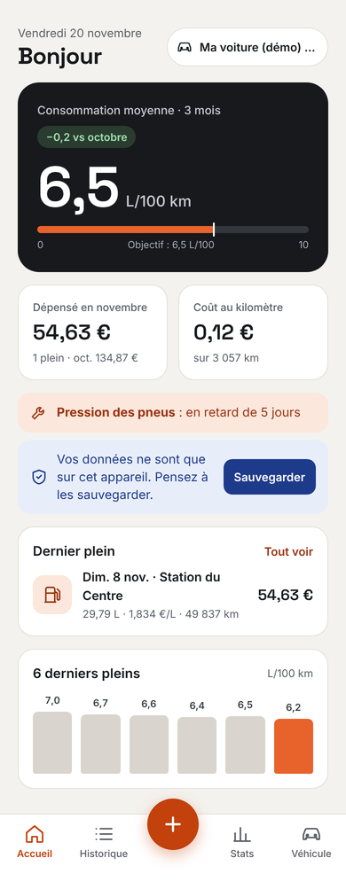
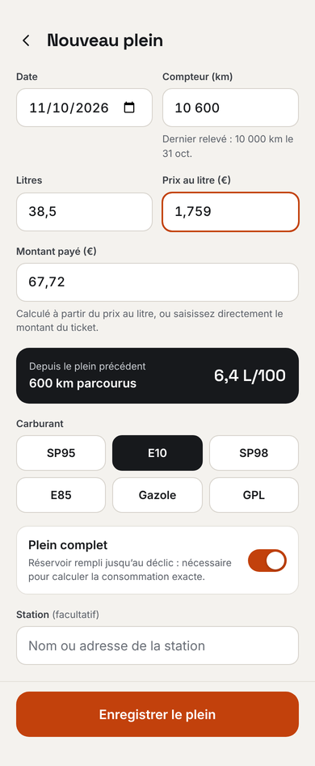
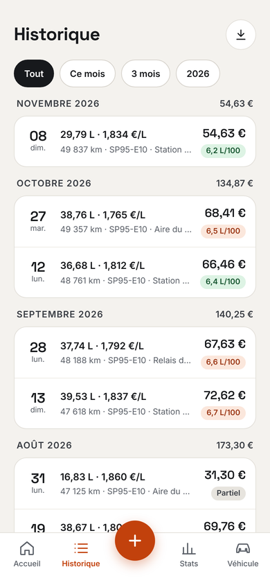
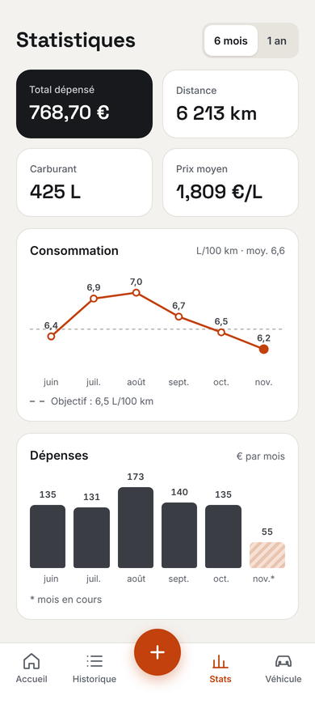

# Suivi Carburant

Application web installable (PWA) pour suivre la consommation de carburant de son véhicule :
pleins, dépenses, consommation de plein à plein, statistiques et rappels d'entretien.
**Les données restent sur l'appareil** : pas de compte, pas de serveur, pas de pistage.

| Accueil | Nouveau plein | Historique | Statistiques |
| --- | --- | --- | --- |
|  |  |  |  |

## Fonctionnalités

- Saisie d'un plein en quelques secondes : montant calculé automatiquement (ou prix au litre
  déduit du ticket), aperçu de la distance et de la consommation, suggestions de stations.
- Consommation exacte par la méthode de plein à plein (pleins partiels pris en compte),
  en L/100 km ou en km/L, avec objectif personnel.
- Accueil : moyenne sur 3 mois, tendance, dépenses du mois, coût au kilomètre, derniers pleins.
- Historique par mois, filtres de période, modification et suppression des pleins.
- Statistiques sur 6 mois ou 1 an : totaux, courbe de consommation, dépenses mensuelles.
- Plusieurs véhicules, autonomie estimée, rappels d'entretien (vidange, contrôle technique…).
- Sauvegarde et restauration (fichier JSON, option chiffrée par mot de passe), export CSV.
- Fonctionne hors ligne, s'installe sur l'écran d'accueil (Android, iPhone, ordinateur).
- Données de démonstration pour essayer tout de suite.

## Lancer l'appli sur son ordinateur

Prérequis : [Node.js](https://nodejs.org) 20 ou plus récent.

```bash
npm start            # puis ouvrir http://localhost:8080
```

Aucune installation n'est nécessaire pour lancer l'appli : le serveur local n'a pas de dépendance.

## Tests

```bash
npm install          # installe l'unique dépendance de test (fake-indexeddb)
npm test             # 40 tests unitaires et d'intégration

# Parcours complet dans un vrai navigateur (facultatif)
npm install --no-save playwright && npx playwright install chromium
npm run test:e2e     # captures d'écran dans captures/
```

## Mettre l'appli en ligne gratuitement

Le dossier `public/` contient tout le site : aucune compilation n'est nécessaire.
Les trois hébergeurs ci-dessous fournissent le HTTPS, indispensable au mode hors ligne.

### Option 1 — Netlify (le plus simple, en-têtes de sécurité appliqués)

1. Créez un compte gratuit sur [netlify.com](https://www.netlify.com).
2. Sans Git : menu **Add new project → Deploy manually**, puis glissez le dossier `public/`.
3. Avec GitHub : **Add new project → Import an existing project**, choisissez le dépôt ;
   `netlify.toml` indique déjà le dossier à publier.
4. Le fichier `public/_headers` est appliqué automatiquement (CSP, anti-cadre, etc.).

L'offre gratuite donne 300 crédits par mois (limite stricte, sans carte bancaire). L'appli pèse
environ 450 Ko et reste en cache sur le téléphone : son usage consomme très peu ; chaque mise en
ligne coûte en revanche 15 crédits, regroupez donc vos modifications.

### Option 2 — Cloudflare Pages (en-têtes de sécurité appliqués)

1. Créez un compte gratuit sur [dash.cloudflare.com](https://dash.cloudflare.com).
2. **Workers & Pages → Create → Pages**, puis connectez le dépôt GitHub
   (ou « Upload assets » et déposez le dossier `public/`).
3. Réglages de build : *Framework preset* = None, *Build command* = vide,
   *Build output directory* = `public`.
4. Le fichier `public/_headers` est appliqué automatiquement.

### Option 3 — GitHub Pages

1. Créez un dépôt public sur GitHub et envoyez-y le projet (branche `main`).
2. **Settings → Pages → Build and deployment → Source** : choisissez **GitHub Actions**.
3. Le workflow `.github/workflows/github-pages.yml` lance les tests puis publie `public/`
   à chaque envoi sur `main`. L'adresse s'affiche dans l'onglet **Actions**.

GitHub Pages ignore `_headers` : la politique de sécurité est alors appliquée par la balise
`<meta>` d'`index.html`, et le refus d'affichage dans un cadre par le code de démarrage.
Si vous choisissez Netlify ou Cloudflare, vous pouvez supprimer ce workflow.

### Nom de domaine (facultatif)

Les trois hébergeurs acceptent un nom de domaine personnel et fournissent le certificat HTTPS.

## Publier une mise à jour

1. Modifiez les fichiers dans `public/`.
2. Incrémentez `VERSION` dans `public/sw.js` et `APP_VERSION` dans `public/js/domain/constants.js`.
3. Lancez `npm test`, puis publiez. Les utilisateurs verront « Une nouvelle version est disponible ».

## Documentation

- [ARCHITECTURE.md](ARCHITECTURE.md) : organisation du code, flux de données, calculs.
- [SECURITY.md](SECURITY.md) : mesures de sécurité et limites.

## Licences

Polices Inter et Space Grotesk : SIL Open Font License 1.1 (fichiers dans `public/assets/fonts/`).
